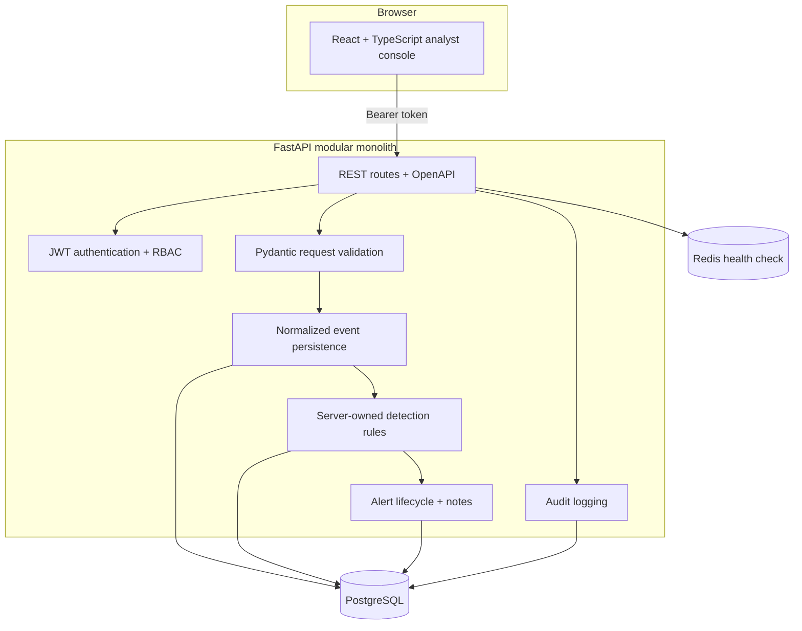

# Architecture

BreachWatch is a modular monolith: one FastAPI application with explicit boundaries between transport, authorization, validation, detection, persistence, and presentation. That shape keeps the project easy to run and review while making the security-sensitive decisions visible.

## Event-to-alert flow

1. An authenticated client submits a normalized event, a bounded demo request, or a UTF-8 JSON-lines upload.
2. Pydantic validates the payload and the API stores it in `security_events`.
3. Enabled server-owned rules evaluate the event synchronously. Rule configuration is JSON, but only known fields and bounded values are accepted; executable rule code is never accepted from a user.
4. New detections create an `alerts` row and link the triggering records through `alert_events`. Open alerts are updated rather than duplicated for the same rule, source, and user context.
5. Analysts update status or add notes. These actions, along with authentication, ingestion, rule changes, and demo generation, produce `audit_logs` records.

The dashboard reads aggregate data, recent alerts, and recent events from the same API. It does not use a separate reporting database or a background queue in this portfolio implementation.

## Deployment boundaries

- **Frontend:** Vite serves the React console on port 5173 and calls the API configured by `VITE_API_URL`.
- **Backend:** Uvicorn serves FastAPI on port 8000. Docker Compose runs the seed command before the API process so demo users and rules are available.
- **PostgreSQL:** Stores users, normalized events, rules, alerts, relationships, notes, and audit records. Compose persists it in a named volume.
- **Redis:** The current code performs a bounded connectivity check from `/api/health`; distributed rate limiting is a documented production follow-up, not a current capability.
- **Local fallback:** Setting `DATABASE_URL=sqlite:///./breachwatch.db` supports a small single-process development run. The checked-in tests use isolated in-memory SQLite fixtures.

## Design choices and trade-offs

- A modular monolith keeps detection and authorization close to the data model, which is useful for an interview-sized codebase and avoids pretending that a queue or service mesh exists.
- Detection runs in the request transaction so the demo can show evidence immediately. Larger event volumes would need profiling and likely an asynchronous ingestion path.
- The startup path uses SQLAlchemy `create_all` plus an idempotent seed operation. The `migrations/` directory is a reference artifact; a production deployment should use a versioned migration runner.
- The frontend provides a focused analyst workflow rather than a full SIEM feature set. It intentionally favors explainability and clear state transitions over broad connector coverage.

The demo seed creates users and rules, then the dashboard's **Generate demo sequence** action exercises the same ingestion and detection path used by API clients. No alert is inserted directly by seed data.
