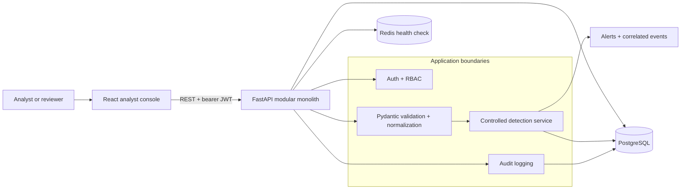

# BreachWatch

> An evidence-first security operations workspace for turning normalized security events into explainable alerts and documented analyst decisions.

BreachWatch is a portfolio project that models the part of a security operations workflow that is easy to lose in a generic dashboard: the evidence behind a detection, the action taken by a person, and the audit trail that explains what happened next. It is intentionally defensive and uses synthetic data throughout the demo.

## Why this project exists

I built BreachWatch to explore the seam between detection logic and analyst workflow. A useful alert is more than a red counter: it should identify the bounded rule that matched, link to the events that caused it, recommend a next step, and preserve the analyst's outcome.

The implementation keeps those boundaries visible in a modular monolith. FastAPI owns request validation and authorization, a small detection service owns server-controlled rules, PostgreSQL stores the evidence and investigation state, and the React console presents a focused queue. This keeps the project simple to run and straightforward to review while still demonstrating security controls, persistence, and a complete user journey.

## At a glance

| Layer | Technology | Purpose |
| --- | --- | --- |
| Analyst console | React, TypeScript, Vite, Recharts | Dashboard, event explorer, alert investigation, rules, and audit views |
| API | Python 3.12+, FastAPI, Pydantic, SQLAlchemy | Authenticated REST API, validation, normalization, detection, and persistence |
| Data services | PostgreSQL 16, Redis 7 | Durable application data plus a lightweight health integration |
| Security | bcrypt, expiring JWTs, server-side RBAC | Password protection, access tokens, and mutation authorization |
| Checks | Pytest, Vitest, TypeScript/Vite build | Backend behavior, frontend helpers, and production bundle validation |

## The product journey

1. **Open the workspace.** Sign in as the seeded analyst account and land on a status-oriented dashboard.
2. **Create safe evidence.** Click **Generate demo sequence** to send six clearly labeled synthetic authentication events through the real ingestion path.
3. **Understand the signal.** The enabled brute-force and authentication-anomaly rules correlate the sequence and create explainable alerts.
4. **Investigate.** Open an alert to review its triggering events, explanation, recommended action, current status, and investigation notes.
5. **Record the decision.** Acknowledge, investigate, resolve, or mark an alert as a false positive. Each sensitive action is written to the audit trail.
6. **Compare access.** The viewer account can read the workspace but cannot ingest data, change alert state, add notes, edit rules, or view the audit page.

The demo sequence is deliberately synthetic. A production deployment would connect approved event sources and would not present generated activity as live telemetry.

## Feature highlights

### Analyst experience

- Dashboard status summary, event volume, alert distribution, recent activity, and attention queue.
- Searchable and filterable normalized event stream with server-side pagination support.
- Alert detail view with correlated evidence, severity, rule context, recommended action, status lifecycle, and notes.
- Role-aware navigation for Dashboard, Events, Alerts, Rules, and Audit.

### Backend capabilities

- Normalized event ingestion through REST, a bounded synthetic generator, and UTF-8 JSON-lines (`.jsonl`/`.log`) uploads capped at 2 MB.
- Five server-owned detection rules: brute-force authentication, authentication anomaly, suspicious request patterns, privilege-change indicators, and event bursts.
- Explainable alerts linked to their triggering events through `alert_events`.
- PostgreSQL persistence, seed data, health checks, OpenAPI documentation, and an audit record for authentication, ingestion, rule, alert, and investigation actions.

### Security-focused design

- Passwords are stored as bcrypt hashes; protected API routes require a signed, expiring bearer token.
- Role checks run on the API for every protected mutation; frontend role checks only shape presentation.
- Rule configuration accepts bounded JSON fields and never accepts executable detection code.
- Pydantic validates event and note payloads, SQLAlchemy parameterizes database queries, and demo IPs use RFC 5737 documentation ranges.

## Detection rules included in the demo

| Rule | Default behavior | Severity |
| --- | --- | --- |
| Brute-force authentication | Five failed authentication events for the same user/source within five minutes | High |
| Authentication anomaly | A successful login after recent failures from the same user/source within ten minutes | High |
| Suspicious request pattern | Documented traversal, SQL-like, script, or command indicators in HTTP request context | Critical |
| Privilege escalation indicator | A privilege-change event without an approved/success status | Critical |
| Event burst anomaly | Twenty events from one source within one minute | Medium |

Thresholds and bounded settings are stored as JSON configuration owned by the server. Only an admin can change rule enablement or configuration.

## Architecture



Events enter through REST or the bounded demo generator, are validated into a normalized model, and are evaluated synchronously against server-owned rules. Alerts reference their evidence through a join table; investigation state and audit records remain queryable after a restart. The backend can fall back to SQLite for a small local-only run, while Docker Compose supplies the documented PostgreSQL and Redis path.

See [ARCHITECTURE.md](ARCHITECTURE.md) for the boundary decisions and data flow in more detail.

## Access model

| Role | Read workspace data | Ingest events / generate demo | Update alerts and notes | Edit rules | View audit |
| --- | --- | --- | --- | --- | --- |
| Admin | Yes | Yes | Yes | Yes | Yes |
| Analyst | Yes | Yes | Yes | No | Yes |
| Viewer | Yes | No | No | No | No |

Newly registered users default to the viewer role. The API is the source of truth for these permissions.

## Demo accounts

The Compose seed creates three synthetic identities. The login form is pre-filled with the analyst account, and [DEMO.md](DEMO.md) contains the intentionally predictable demo-only passwords and the five-minute walkthrough.

| Account | Role | Use it to show |
| --- | --- | --- |
| `admin@breachwatch.local` | Admin | Rule controls and the full audit view |
| `analyst@breachwatch.local` | Analyst | The primary event-to-alert investigation flow |
| `viewer@breachwatch.local` | Viewer | Read-only access and server-side RBAC enforcement |

These credentials are for local synthetic data only. Replace the seeded values and secret key before using the code in any shared or production-like environment.

## Quick start with Docker

### Prerequisites

- Docker Desktop (or Docker Engine) with Compose v2.

### Start the stack

PowerShell:

```powershell
Copy-Item .env.example .env
docker compose up --build
```

macOS/Linux:

```bash
cp .env.example .env
docker compose up --build
```

Open these URLs after the services are healthy:

- UI: <http://localhost:5173>
- API health: <http://localhost:8000/api/health>
- Interactive API docs: <http://localhost:8000/docs>

The backend seeds users and rules on startup. PostgreSQL data persists in the named Compose volume between restarts. To stop the stack, run `docker compose down`. To reset the local demo database as well, run `docker compose down -v` (this deletes the local database volume).

## Local development without Docker

This path uses SQLite for the backend and does not require Redis. Without a running Redis service, `/api/health` reports Redis as unavailable while the rest of the local workflow remains usable.

### Backend

Use Python 3.12 or newer:

```powershell
cd backend
python -m venv .venv
.\.venv\Scripts\Activate.ps1
python -m pip install -r requirements.txt
$env:DATABASE_URL = "sqlite:///./breachwatch.db"
$env:SECRET_KEY = "local-only-change-me"
$env:CORS_ORIGINS = "http://localhost:5173"
python -m app.seed
python -m uvicorn app.main:app --reload --port 8000
```

On macOS/Linux, activate the environment with `source .venv/bin/activate` and use `export NAME=value` for the environment variables above.

### Frontend

In a second terminal, use Node.js 22 or newer:

```powershell
cd frontend
npm ci
$env:VITE_API_URL = "http://localhost:8000/api"
npm run dev
```

The Vite default already points at the same API URL, so the environment variable can be omitted when using the default ports.

## Validation commands

Run these from the indicated directories after installing the local dependencies:

```powershell
# Backend unit/API tests (uses isolated SQLite fixtures)
cd backend
python -m pytest -q

# Frontend tests and production build
cd ..\frontend
npm test
npm run build

# Validate Compose interpolation without starting services
cd ..
docker compose config --quiet
```

The existing test suites cover authentication, password hashing, RBAC, event and log-file ingestion, bounded rule configuration, detection evidence, alert lifecycle, audit records, filters, and presentation helpers. See [docs/TEST_REPORT.md](docs/TEST_REPORT.md) for the recorded smoke-test notes and known gaps.

## Security posture and limitations

This repository demonstrates security-minded application boundaries; it is not a production-ready SIEM or a compliance-certified system. Important limitations are documented in [SECURITY.md](SECURITY.md), including the local demo's browser token storage, lack of refresh tokens, synchronous detection path, startup schema creation instead of a migration runner, limited alert pagination, and the need for TLS, key rotation, centralized logging, and distributed rate limiting in a real deployment.

## Repository map

```text
backend/app/       FastAPI routes, auth, models, detection, seed data
backend/tests/     Pytest API, security, and detection coverage
frontend/src/      React analyst console and frontend helpers
migrations/        SQL reference migration
docs/              Test report and supporting project notes
API.md             Endpoint summary and OpenAPI entry point
ARCHITECTURE.md    Detailed architecture and design choices
DEMO.md            Five-minute walkthrough and demo credentials
SECURITY.md        Security controls, scope, and production gaps
```

## Project documents

- [Architecture](ARCHITECTURE.md)
- [Security posture](SECURITY.md)
- [API surface](API.md)
- [Five-minute demo](DEMO.md)
- [Test report](docs/TEST_REPORT.md)
